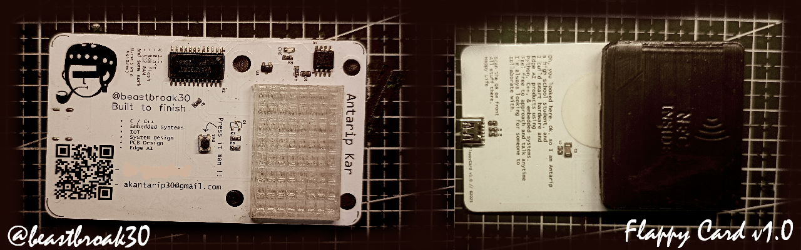

  

---
I am a student, but I love to call myself an Embedded Systems Engineer and IoT Developer, with experience in hardware development, bare-metal, RTOS, and Edge AI.
Welcome to my page; on my Github, you can find:

- Projects created by me
- Low-level programming
- IoT, hardware and Edge AI solutions
- AI/ML Projects
  
#### 📧 Where you can find me
 

#### 📜 Github stats:

 

---
### I am a student who wants to do, and tries to do, full-time embedded systems engineering.

In my view, the best approach is to pick the tech that's just right for the problem.
Additionally, I enjoy expanding my knowledge, and because of that, I am open to learning new technologies and languages 🐱‍👓

### My current technology stack:
        

### Tech that I am using but less 
     
--- 

#### In the meantime, I am researching the next system that could make Edge AI more powerful.
- Paper in review: RSSI-based Human Sensing Project (Human Presence Estimation using RSSI)
- Working on KANRE (Embedded system solutions).
- Love to play lawn tennis and kho-kho.
- **If you have seen the above image banner, that is actually a card that plays Flappy Bird [Demo Here](assets/readmecard.md)**

#### List of Honors
- International Scholarship: Selected for the [Natsuyasumi Project '26](https://www.natsuproject.org/) in Tokyo, Japan, as an Independent Researcher
- Research Funds Granted by Emergent Venture Fellow for TRNG development. 
- IIT Bombay Meshmerize Champion: Ranked 1st Place at the zonal level, competing as the only school team against 38 college-level teams.
- Scientific Publication: Authored and submitted a peer-reviewed manuscript on RSSI-based Human Presence Estimation.
- Got accepted into the TIB maker lab and Membership (Sadly, I couldn’t join due to geographical constraints.)
